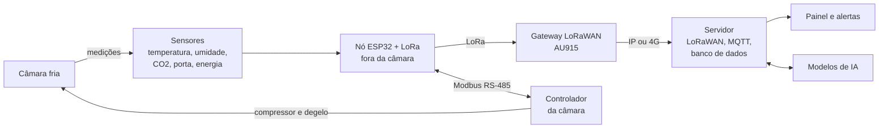

# IFSC-cooperamais: FrioConecta

**Cadeia do frio conectada, inteligente e eficiente para a agricultura familiar.**

Repositório do projeto FrioConecta, do IFSC Câmpus São José, em parceria com a COOPERFAMILIA (Cooperativa dos Agricultores Familiares de Rio Fortuna e Santa Catarina). O objetivo é monitorar, controlar e tornar mais eficientes as câmaras frias de cooperativas da agricultura familiar, com sensores de baixo custo, rede LoRa, painel de dados e inteligência artificial.

> **Status:** em desenvolvimento. O código deste repositório é o ponto de partida do projeto (TRL 3). A estação IoT base funciona em bancada; o firmware v0 do nó da câmara ainda não foi testado em câmara fria.

## Onde estamos

| Etapa | Situação |
| --- | --- |
| Estação IoT com ESP32, sensores de temperatura e umidade e painel em nuvem (PJI3, 2026/1) | Funcionando em bancada |
| Firmware v0 do nó FrioConecta: faixa de temperatura, porta, alarmes, telemetria em JSON e fila offline | Escrito; a testar em bancada |
| Nó com rádio LoRa e rede LoRaWAN (AU915) | Planejado (M3) |
| Câmaras experimentais instrumentadas no IFSC | Planejado (M2) |
| Integração Modbus com o controlador da câmara | Planejado (M4) |
| Modelos de IA: anomalias, previsão, manutenção preditiva e vida útil | Planejado (M6) |
| Piloto na câmara da agroindústria da cooperativa | Planejado (M8) |

## Arquitetura



O nó fica do lado de fora da câmara, porque os painéis metálicos bloqueiam o rádio. O controlador comercial mantém a segurança do compressor e do degelo; o FrioConecta lê os dados e ajusta os setpoints.

## Estrutura do repositório

```
firmware/
  estacao_iot_base/     código da estação IoT (ponto de partida, TRL 3)
  frioconecta_no_v0/    primeira versão do nó de monitoramento da câmara
docs/
  relatorio_estacao_iot_pji3_2026-1.pdf   relatório técnico da estação
hardware/
  componentes.md        componentes atuais e previstos
```

## Ponto de partida: estação IoT (TRL 3)

A estação IoT foi desenvolvida no Projeto Integrador 3 (PJI3) da Engenharia de Telecomunicações do IFSC Câmpus São José, em 2026/1. Um ESP32 lê sensores de temperatura e umidade (DHT22), temperatura e pressão (BMP280) e chuva. A cada 30 segundos, envia os dados por Wi-Fi e HTTPS para a plataforma ThingsBoard, com painel de séries temporais em tempo real.

Ela demonstra em bancada a cadeia central do FrioConecta: sensoriamento, transmissão sem fio, armazenamento e visualização. O relatório técnico, com fotos da montagem e telas do painel, está em [`docs/`](docs/relatorio_estacao_iot_pji3_2026-1.pdf).

Autores: Beatriz Papst Abreu, Gian Gabriel Fagundes Santos, Jean Motta Caitano dos Reis, Joana da Silva e Wagner Flores dos Santos.

## Firmware v0 do nó FrioConecta

Adapta a estação ao uso em câmara fria:

- média móvel da temperatura e leitura de umidade (DHT22);
- sensor de porta (reed switch) e tempo de porta aberta;
- alarmes de temperatura fora da faixa, com tempo de persistência, e de porta aberta por tempo demais;
- telemetria em um único JSON para um dispositivo do ThingsBoard;
- fila de mensagens para reenvio quando a rede cai.

Para usar, preencha a rede Wi-Fi e o token do dispositivo no início do arquivo e ajuste a faixa de temperatura (`TEMP_MIN`, `TEMP_MAX`). Bibliotecas: DHT sensor library e Adafruit Unified Sensor (Arduino IDE, placa ESP32).

## Roteiro do projeto (36 meses)

| Meta | Descrição | Meses |
| --- | --- | --- |
| M1 | Diagnóstico e requisitos na cooperativa | 1 a 6 |
| M2 | Laboratório FrioConecta: câmaras experimentais e bancada com fluido natural | 3 a 14 |
| M3 | Nó sensor com LoRa e rede LoRaWAN | 3 a 18 |
| M4 | Plataforma de dados, painel e integração com o controle | 6 a 20 |
| M5 | Eficiência energética | 12 a 30 |
| M6 | Modelos de inteligência artificial | 12 a 32 |
| M7 | Ensaios com produtos da cooperativa | 15 a 30 |
| M8 | Piloto de campo na agroindústria (TRL 6) | 22 a 33 |
| M9 | Transferência de tecnologia e capacitação | 24 a 36 |

## Equipe

IFSC Câmpus São José:

- João Carlos Bez Batti, Diretor-Geral do Câmpus São José (coordenação geral e técnica)
- Prof. Dr. Ramon Mayor Martins, Telecomunicações
- Profa. Dra. Deise Monquelate Arndt, Telecomunicações
- Prof. Dr. Diego da Silva de Medeiros, Telecomunicações
- Prof. Dr. Marcos Antonio Garcia, Refrigeração e Ar Condicionado

Cooperativa parceira: COOPERFAMILIA, Rio Fortuna (SC).

## Licença

A definir com os autores e o Núcleo de Inovação Tecnológica do IFSC, conforme a Política de Inovação da instituição. O código da estação IoT base é de autoria dos estudantes listados acima.
